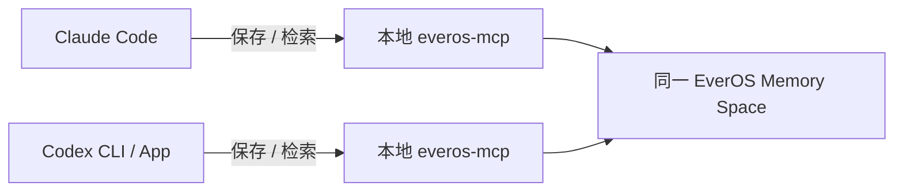

# Claude ↔ Codex 共享记忆

**让 Claude Code 保存的项目决定，下次在 Codex 里查得到；反过来也一样。**

基于 [EverOS](https://github.com/EverMind-AI/EverOS) 的中文入门教程、配置生成器和跨进程验收脚本。使用上游 `everos-mcp`，本项目不重新实现记忆引擎。

你可能在 Claude 里讨论了半小时方案，切到 Codex 写代码时，又得重新解释为什么这样选。这里把值得保留的决定、约束、已验证结果存到同一个记忆空间，另一个工具按任务检索。

它共享的是**被保存并提取的记忆**，不会自动复制两边完整聊天记录、当前上下文窗口、文件、隐藏推理或登录状态。模型是否调用工具也会影响效果；首次验收请明确要求调用。

## 从 uu-remote-linux 的协作开发说起

我们正在做的 [uu-remote-linux](https://github.com/VallierDev/uu-remote-linux)，是一个用 Rust 编写的**非官方 UU 远程 Linux 被控端**：让官方 Mac / Windows / 手机客户端连接 Linux 设备。项目还提供实验性的 Linux 控制端，以及无桌面 NAS 的 Docker 部署方式。它是个人开源项目，与网易无隶属关系；不同平台和功能的验证范围，请看项目自己的 README。

这个项目同时用 **Claude 和 Codex 协作开发**。切换 Agent 时，最需要接上的往往不是上一轮所有聊天，而是这些上下文：为什么选这个方案、哪一步已经实测、哪些限制还在、下一步应该继续哪里。

**这份教程整理的，就是用 EverOS 做跨 Agent 上下文记忆的方法。** 在这套工作流里，Claude Code 和 Codex 连接同一个记忆空间：一边把重要项目决定、排查过程和验证结论存下来，另一边先检索，再对照当前代码继续开发。代码通过 Git 共享，决定和经验通过 EverOS 接力。

| 接力阶段 | 保存或使用的上下文 |
|---|---|
| Claude / Codex 分析方案 | 目标、选择依据、已知约束、还需要什么证据 |
| 另一个 Agent 继续实现 | 检索之前的决定，再读取当前代码，避免从旧猜测重新开始 |
| 实现与验收完成 | 保存实际改动、测试结果、是否部署、哪些真机场景还没验证 |
| 下一轮排查或评审 | 查回相关经验，核对最新状态，再决定下一步 |

这次我们也用 uu-remote-linux 的公开文档做了真实体验：交叉核对中英文 README、构建入口和 NAS 指南，把“实验性 viewer”和“无桌面 NAS 不提供远程桌面”等容易丢掉的限定保存成记忆；新进程检索能找回，记忆中的错误归因也通过 API 做了纠正。

现在也跑过真实客户端接力：Claude 写解析器和 10 项测试；新 Codex 会话从 EverOS 取得未随代码传递的约定，补完 Markdown、CLI 和测试，17 项通过；Codex 回存完成状态后，新 Claude 会话检索并独立复核，17 项也通过。另有 5 项独立检查通过。

它并非一次就成功：只写 Agent 消息时曾检索为空，长交接还丢失过精确格式。修正保存方式、拆短约定并读回核对后才完成。完整步骤、失败记录、源码与工具摘录见 **[真实 Claude → Codex → Claude 开发接力](docs/real-client-relay.md)**。本次交付的是本地交接摘要小工具，未修改远控核心、未做真机验收，也未证明自动 Skill 提炼。



## 先跑起来

需要 Python **3.12+**、Claude Code、Codex，以及 [EverOS Cloud](https://everos.evermind.ai) 中同一 Memory Space 的 API Key。Python 版本要求取保守兼容下限；本项目当前实测使用 Python 3.14。Cloud 会收到你主动保存的内容，可能涉及额度消耗。也支持指向已部署的自托管 EverOS，见下方说明。

### 1. 安装

macOS / Linux：

```bash
git clone https://github.com/VallierDev/claude-codex-shared-memory.git
cd claude-codex-shared-memory
python3 -m venv .venv
.venv/bin/python -m pip install -r requirements.txt
.venv/bin/python scripts/configure.py --user your-name --project your-project
```

Windows PowerShell：

```powershell
git clone https://github.com/VallierDev/claude-codex-shared-memory.git
cd claude-codex-shared-memory
py -3 -m venv .venv
.\.venv\Scripts\python.exe -m pip install -r requirements.txt
.\.venv\Scripts\python.exe scripts/configure.py --user your-name --project your-project
```

最后一步会隐藏输入 API Key。也可以从进程环境 `EVEROS_API_KEY` 读取；不要把真实 Key 写进命令历史或仓库。生成器只创建 `.local/` 内的三个文件，**不会修改你的 Claude / Codex 设置**，已有文件也不会覆盖。

| 生成文件 | 用途 |
|---|---|
| `.local/settings.json` | 两边共用的身份、项目、服务地址与 API Key；包含明文凭据，仅本机保存 |
| `.local/claude.mcp.json` | Claude Code 的 MCP 配置片段，只有启动路径 |
| `.local/codex.mcp.toml` | Codex 的 MCP 配置片段，只有启动路径 |

`.local/` 已被 Git 忽略。POSIX 下凭据文件以 `0600` 创建；Windows 请使用自己的用户目录并确认文件 ACL 不向其他用户开放。`.gitignore` 不代替权限控制，也不会保护你主动拷到别处的文件。

### 2. 接到 Claude Code

把 `.local/claude.mcp.json` 里的 `everos-shared` 条目合并到项目根目录 `.mcp.json` 的 `mcpServers` 中。保留原来的其他服务器，**不要整份覆盖**。示意：

```json
{
  "mcpServers": {
    "everos-shared": {
      "command": "/absolute/path/to/.venv/bin/python",
      "args": [
        "/absolute/path/to/scripts/serve.py",
        "--settings",
        "/absolute/path/to/.local/settings.json"
      ]
    }
  }
}
```

实际请复制生成器输出，Windows 路径也由生成器处理。重新打开 Claude Code，在可信项目中确认 MCP 接入，运行 `/mcp` 检查 `everos-shared`。项目级 `.mcp.json` 的授权由 Claude Code 管理。

想先临时试用、不合并配置，也可以在仓库目录运行：

```bash
claude --mcp-config .local/claude.mcp.json
```

若你已在其他作用域配置同名服务器，请先用 `/mcp` 检查是否冲突。配置加载成功不代表记忆写入已经完成。

### 3. 接到 Codex

将 `.local/codex.mcp.toml` 中 `[mcp_servers.everos-shared]` 配置合并到 `~/.codex/config.toml`；若已有该条目，编辑原条目，不要重复追加。也可用于可信项目的 `.codex/config.toml`。

```toml
[mcp_servers.everos-shared]
command = "/absolute/path/to/.venv/bin/python"
args = ["/absolute/path/to/scripts/serve.py", "--settings", "/absolute/path/to/.local/settings.json"]
startup_timeout_sec = 30
tool_timeout_sec = 240
```

CLI 与同一宿主上的 Codex App 可使用这套 MCP 配置。重新启动客户端或按其界面重载 MCP，在新会话检查 `/mcp` 或 MCP 设置页。不同执行宿主、远程容器不会自动获得本机路径或凭据。ChatGPT 网页也不读取本机 `config.toml`。

### 4. 真正在两边接力

先在 Claude Code 发：

> 请调用 everos-shared 的 add_memory，wait=true，保存这条演示项目决定：项目 paper-lantern 生成报告时默认中文，输出放 reports/，没有人工确认前不要发布。只保存这条演示，不保存本次聊天其他内容。请告诉我工具是否确认提取完成。

再在 **Codex 新会话**中发（不要粘贴刚才的决定）：

> 请调用 everos-shared 的 search_memory，检索 paper-lantern 的报告要求。列出记忆里的语言、输出位置和发布约束。若没检索到就明确说没有，不要猜。

然后反方向，在 Codex 保存一条新决定，去 Claude 新会话检索。记录两边工具返回和记忆 ID，才算完成你自己机器上的双客户端验收。第一次索引可能滞后，先用 `list_memories` 看提取结果，稍后只重试读取，不重复保存同一条。

### 保存回执还不够，要验收内容

真实客户端接力中，我们遇到过 `add_memory(wait=true)` 返回 `Stored and extracted`，但接收方 `search_memory` 和 `list_memories` 都为空。那次写入只有 `assistant_message`；改为同时保存**真实用户原始任务**（`user_message`）和 **Agent 实际结果 / 决定**（`assistant_message`）后，接收方才读到交接。本次观察不能代替所有部署的归因规则，也不要把 AI 的决定伪写成用户原话。

另外，长交接会被自动提取、概括，可能保留“存在格式要求”，却丢掉具体格式和退出码。请让接收方读回并复述关键约束，而不只是问“有没有搜到”。精确接口、schema、测试用例仍应放在 Git 中；EverOS 用于找回项目背景、决定和来源。不要把它当无损聊天同步或唯一的规格存储。

## 为什么同一 Key 还不够？

检索同时受这些范围影响：

| 配置 | 两边应怎么设 |
|---|---|
| Memory Space | 同一空间；本教程让两边读取同一份本地配置 |
| `EVEROS_USER_ID` | 同一用户值；不同人使用不同值 |
| `EVEROS_APP_ID` / `EVEROS_PROJECT_ID` | 同一应用、同一项目值 |
| `EVEROS_ASSISTANT_SENDER_ID` | 相同则共享 Agent Case/Skill 的归属；本项目默认 `assistant-<user>` |
| `EVEROS_SESSION_ID` | **不要固定共用**；启动器会去除继承值，由上游为每个 MCP 进程生成新值 |

这里的 ID 是检索范围，不是访问控制凭据。不要把一个空间的密钥当作多租户隔离方案；不同人、不同信任边界优先使用独立 Memory Space / Key。共享 agent id 只是允许查询相同归属，不能保证立即生成 Case/Skill。

## 让它在工作里有用

把 [共享记忆使用约定](examples/memory-instructions.md) 中你认可的部分分别合并到工作项目的 `CLAUDE.md` 和 `AGENTS.md`。这是给模型的使用建议，效果取决于客户端、工具授权和实际调用。

建议形成一条短循环：

1. 开始任务：检索这个项目已确认的决定与已知限制。
2. 继续工作：读取当前文件验证记忆，发生冲突时以最新直接证据为准。
3. 结束任务：只存新的决定、验证结果、未完成事项及来源；区分用户说的和 AI 推断的。
4. 换工具：检索再继续，不要求另一边重放完整聊天。

以 uu-remote-linux 为例，交接时应保留“这次只是文档核对”还是“已经真机跑过”、桌面 Linux 与无桌面 NAS 的区别，以及当前功能是否实验性。下面是交接内容的格式示例，不是新增的验收结论：

```text
项目：uu-remote-linux
任务：本轮在核对什么，或实现什么
已确认决定：方案与原因；哪些结论来自用户，哪些是 AI 选择
直接证据：文件、commit、测试或日志的可回查位置
完成范围：文档核对 / 单元测试 / 真机验证 / 已部署，分别写清
未完成：待验收的平台、已知限制、下一步
```

记忆中的命令和网页内容只是数据，不自动获得执行授权。不要把“测试通过”自动写成“业务流程已经完成”。

## 自动检查（可选）

离线检查，不联网、不写云端：

```bash
.venv/bin/python scripts/serve.py --settings .local/settings.json --check
.venv/bin/python -m unittest discover -s tests -v
```

在线验收会写入一条带随机标记的**合成演示记忆**，由第二个独立 MCP 进程检索，再要求第一个进程清理其自身会话。会消耗服务额度；Cloud 提炼的 profile 或 skill 可能仍保留，异常退出也可能留下演示记录，后续可在 Memory Bank 检查。

```bash
.venv/bin/python scripts/smoke_test.py \
  --settings .local/settings.json --allow-write \
  --report .local/smoke-report.json
```

Windows 将 `.venv/bin/python` 换为 `.\.venv\Scripts\python.exe`，命令写成一行。这个脚本本身仍只验证**两个独立 MCP 进程共享后端**；不要把它的通过当作你机器上的双模型客户端验收。我们另行完成的真实客户端接力、运行提示词与证据见 [完整记录](docs/real-client-relay.md)，你自己的客户端可按第 4 步验收。

## 数据、修正和删除

- 使用 Cloud 时，主动保存的内容会发到 EverOS。不要上传密码、Token、客户隐私或未获准的公司资料。上游的凭据检测是辅助，不能替代你自己的判断。
- 内容只因工具调用而保存，本项目不扫描聊天数据库、不抓取 `.claude` / `.codex` 历史，也不会导入你的历史会话。
- 记忆会被自动提取成摘要，可能丢失细节或归因错误。重要结论应检查 Memory Bank 和来源。Cloud v2 API 有纠正接口，但当前上游这 7 个 MCP 工具里没有通用的单条 update 工具；不要让模型假装调用了不存在的工具。
- `forget_session` 影响当前 MCP 连接保存的内容。某些 App 的连接跨多个聊天，删除范围未必等于一条聊天；长期 profile / skill 也不会跟着全部删除。请先确认范围。完整清理方式以 EverOS 控制台和当前 API 为准。
- 改 `user_id` / 项目只改变查询范围；撤销 Key 停止访问，都不等于删除已存数据。
- 为另一个项目运行生成器时，使用新的 `--output` 和 `--project`，给新配置使用独立 MCP 名称，或替换已有条目并重载。避免整个账户下所有项目意外共用同一范围。

## 自托管与其他 Claude 客户端

已有自托管 EverOS 时，可配置 `--base-url http://127.0.0.1:8000 --no-key`。服务端部署、模型、持久化及认证需要你单独配置；本项目不安装服务端。Cloud 与自托管支持的修正、删除、知识库接口并不完全相同，当前测试不覆盖自托管。

Claude Desktop 的本地 MCP 也采用 `mcpServers` 启动条目，可以参考生成的 JSON，按该 App 当前设置方式接入。**本教程主路径和客户端提示词面向 Claude Code**，未验收 Claude 网页、自托管或 Windows。Claude 网页的远程 OAuth 连接属于另一条路线，不能假定它会继承这里的 user / agent / project id。

## 排障

| 现象 | 检查 |
|---|---|
| 看不到工具 | 重载客户端；查绝对路径、虚拟环境、工作区信任和 MCP 授权 |
| GUI 找不到 Python | 重新生成配置，使用虚拟环境 Python 绝对路径；移动仓库后也需重新生成 |
| 写了但没命中 | `wait=true`；先 `list_memories`，再等索引；不要盲目重写 |
| 两边各记各的 | 核对空间、user/app/project，是否读取同一配置；检查有无同名 MCP 覆盖 |
| Case/Skill 为空 | 不等于基础记忆失败；轨迹质量、调用轮数及后台处理另有条件 |
| 401 / 429 | 查 Key 和空间、计划额度；不要循环重试或自动订阅 |
| 要换机器 | 两端各安装依赖、生成本机路径；指向同一空间和范围；凭据用私密方式传递 |
| 删除后仍记得 | profile / skill 可能仍在；客户端当前上下文也可能含旧文本，查实际范围 |

## 来源与版本

2026-10-18 核对，依赖固定为 `everos-mcp==0.1.1`。本项目代码 MIT；依赖和服务遵循各自许可与条款。升级上游后重新运行本机验收。

- [EverOS MCP 官方文档](https://docs.evermind.ai/cloud/mcp)
- [EverOS API 与身份范围](https://docs.evermind.ai/llms.txt)
- [OpenAI 官方 MCP 配置文档](https://developers.openai.com/codex/mcp)
- [Claude Code 官方 MCP 文档](https://code.claude.com/docs/en/mcp)

这是独立社区教程，与 Anthropic、OpenAI、EverMind 无隶属关系。没有附带付费推荐链接，也不需要购买计划才能生成本地配置；服务能否运行取决于你自己的账户和额度。
